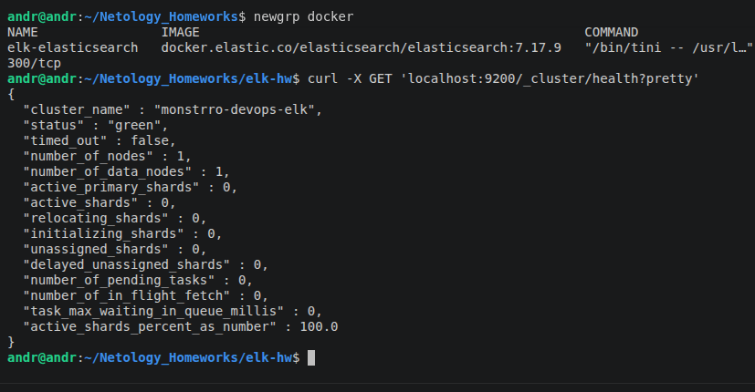
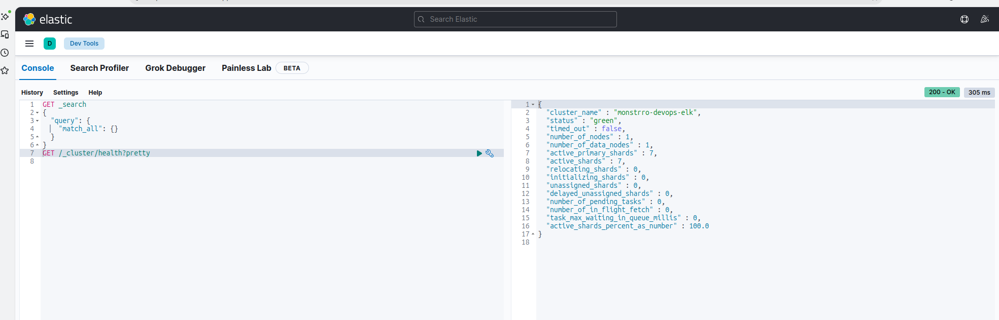
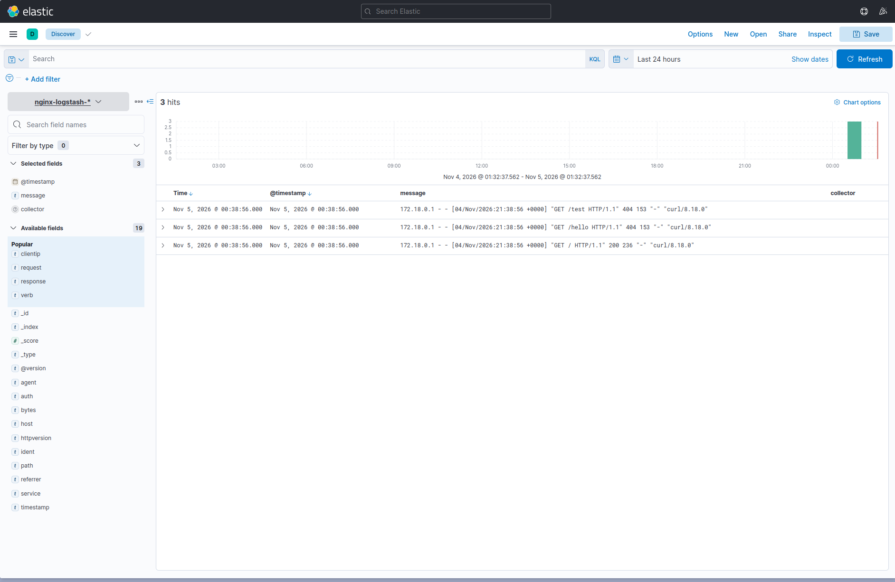
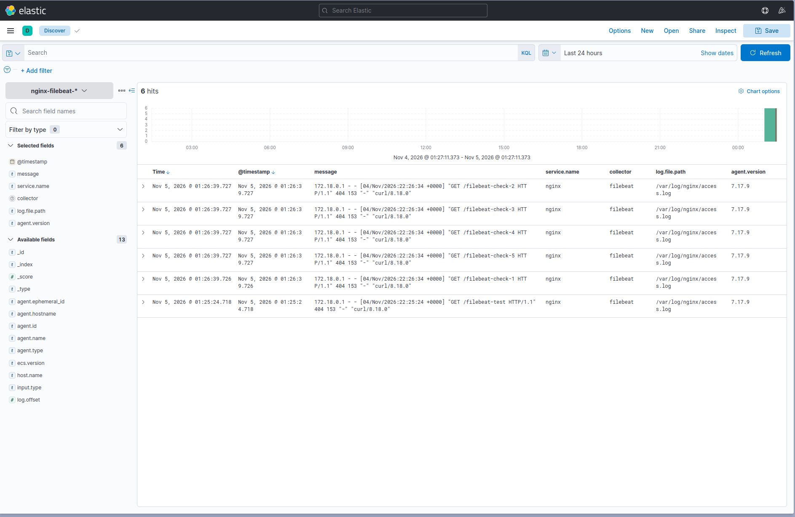

# Домашнее задание: ELK Stack

Развёртывание Elasticsearch, Kibana, Logstash, Filebeat и Nginx с помощью Docker Compose. В проекте продемонстрированы два способа доставки журналов Nginx в Elasticsearch: через Logstash и напрямую через Filebeat.

## Окружение

- Ubuntu 26.04.1 LTS (VirtualBox)
- Docker Engine и Docker Compose
- Elasticsearch, Kibana, Logstash, Filebeat — **7.17.9**
- Nginx — **1.27-alpine**

## Структура проекта

```text
elk-hw/
├── compose.yaml
├── .env.example
├── .gitignore
├── README.md
├── elasticsearch/elasticsearch.yml
├── kibana/kibana.yml
├── logstash/pipeline/nginx.conf
├── filebeat/filebeat.yml
├── nginx/
│   ├── default.conf
│   ├── html/index.html
│   └── logs/                 # журналы не публикуются в Git
└── img/
    ├── 01-elasticsearch-health.png
    ├── 02-kibana-health.png
    ├── 03-nginx-logstash.png
    └── 04-nginx-filebeat.png
```

## Подготовка и запуск

Из каталога `elk-hw`:

```bash
cp .env.example .env
sudo sysctl -w vm.max_map_count=262144
docker compose config --quiet
docker compose up -d
```

Для постоянного применения параметра `vm.max_map_count` можно создать файл `/etc/sysctl.d/99-elasticsearch.conf` со строкой `vm.max_map_count=262144`.

Проверка контейнеров:

```bash
docker compose ps -a
```

Локальные адреса:

- Elasticsearch: `http://localhost:9200`
- Kibana: `http://localhost:5601`
- Nginx: `http://localhost:8080`

> Порты опубликованы только на `127.0.0.1`. Конфигурация предназначена для локальной учебной среды; аутентификация Elasticsearch отключена.

## Задание 1. Elasticsearch

Elasticsearch работает в режиме `single-node`, имя кластера — `monstrro-devops-elk`.

```bash
curl -X GET 'localhost:9200/_cluster/health?pretty'
```

В ходе проверки кластер имел состояние `green`.



## Задание 2. Kibana

Kibana подключена к Elasticsearch. В **Dev Tools → Console** выполнен запрос:

```http
GET /_cluster/health?pretty
```

Получен ответ `200 OK` с информацией о кластере.



## Задание 3. Nginx → Logstash → Elasticsearch → Kibana

Logstash читает общий файл `nginx/logs/access.log`, разбирает строки журнала фильтром `grok`, обрабатывает дату и записывает события в индекс `nginx-logstash-*`.

```text
Nginx → access.log → Logstash → Elasticsearch → Kibana
```

Для проверки можно выполнить:

```bash
docker compose up -d logstash
curl -s -o /dev/null http://localhost:8080/
curl -s -o /dev/null http://localhost:8080/test
curl -s 'http://localhost:9200/nginx-logstash-*/_count?pretty'
```

В **Kibana → Discover** создано представление данных `nginx-logstash-*`. На скриншоте видны три события.



## Задание 4. Nginx → Filebeat → Elasticsearch → Kibana

Filebeat читает `nginx/logs/access.log` и отправляет события непосредственно в Elasticsearch, в индекс `nginx-filebeat-*`.

```text
Nginx → access.log → Filebeat → Elasticsearch → Kibana
```

Для отдельной проверки Filebeat Logstash можно остановить:

```bash
docker compose stop logstash
docker compose up -d filebeat
for i in {1..5}; do
  curl -s -o /dev/null "http://localhost:8080/filebeat-check-$i"
done
sleep 5
curl -s 'http://localhost:9200/nginx-filebeat-*/_count?pretty'
```

В **Kibana → Discover** создано представление данных `nginx-filebeat-*`. На скриншоте показаны шесть событий с полями `@timestamp`, `message`, `service.name`, `collector`, `log.file.path`, `agent.version`.



### Особенность сопоставления полей

При настройке Filebeat поле `service` первоначально было строкой, что вызывало ошибку `mapper_parsing_exception`: Elasticsearch ожидал объект. Конфигурация исправлена на вложенное поле `service.name: nginx`, после чего индексация заработала.

## Дополнительные команды

```bash
# Список индексов
curl -s 'http://localhost:9200/_cat/indices?v'

# Количество документов
curl -s 'http://localhost:9200/nginx-logstash-*/_count?pretty'
curl -s 'http://localhost:9200/nginx-filebeat-*/_count?pretty'

# Журналы контейнеров
docker compose logs --tail=30 logstash
docker compose logs --tail=30 filebeat

# Остановка проекта
docker compose down
```

Команда `docker compose down` не удаляет именованные тома с данными Elasticsearch и состоянием Filebeat. Для удаления томов используется отдельный параметр `-v`, который приведёт к потере этих данных.

## Результат

1. Развёрнут Elasticsearch, проверено состояние кластера.
2. Настроена Kibana, выполнен запрос через Dev Tools.
3. Организован сбор журналов Nginx через Logstash.
4. Организован сбор журналов Nginx через Filebeat.
5. Получение событий подтверждено в Kibana Discover; скриншоты приложены в каталоге `img/`.
