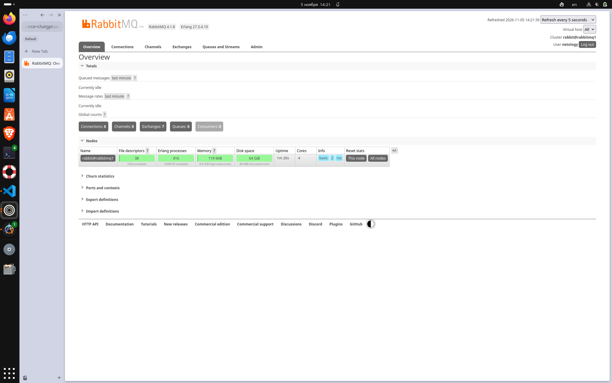
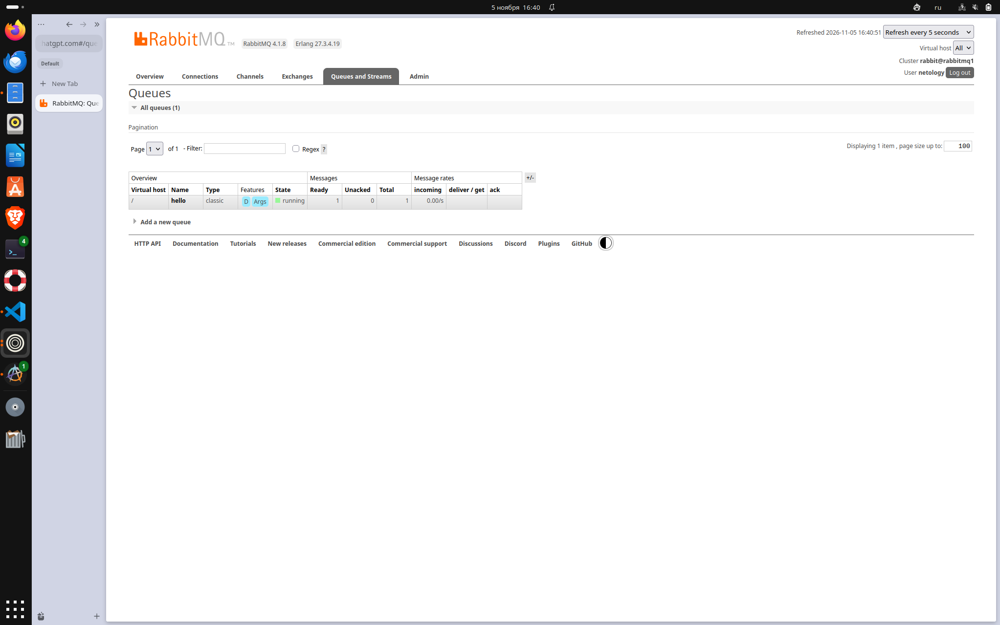
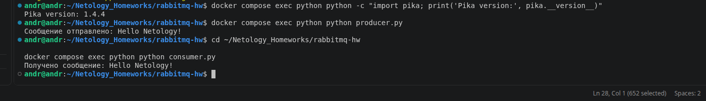
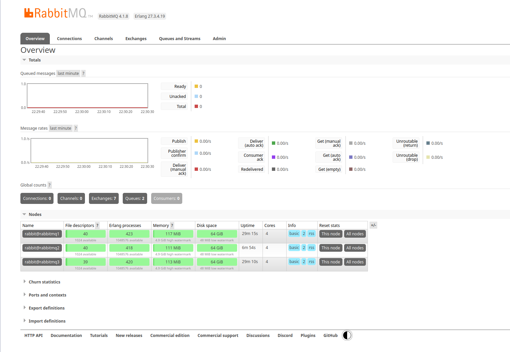
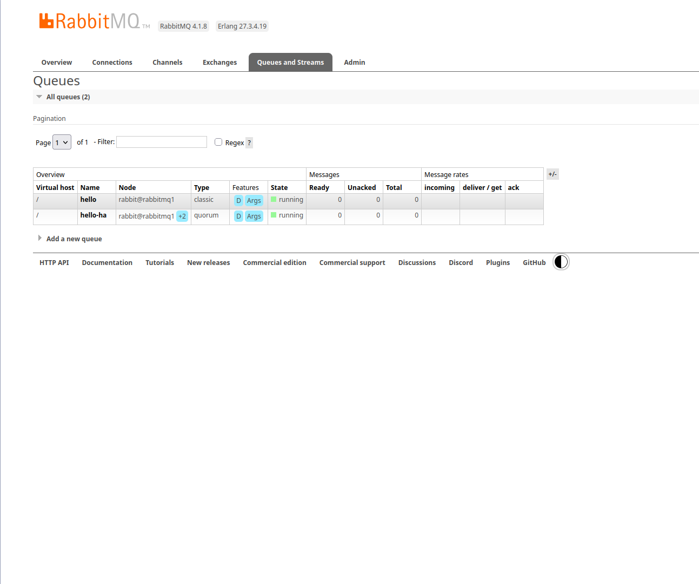
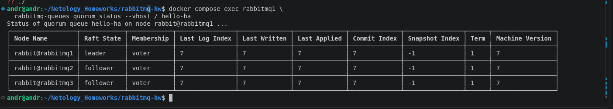
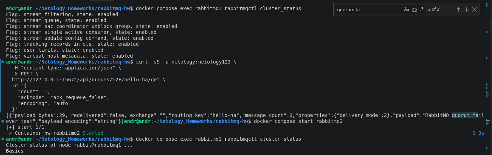
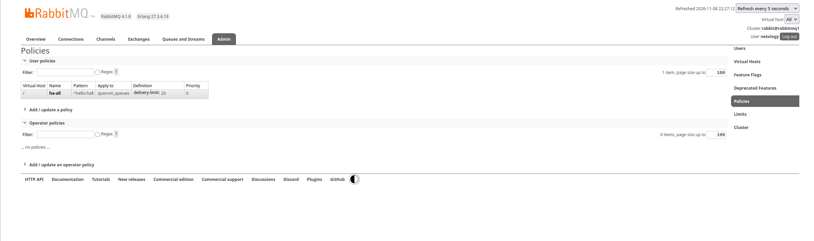

# Домашнее задание «Очереди RabbitMQ»

## Задание 1. Установка RabbitMQ

**Решение**

RabbitMQ развёрнут в Docker с использованием Docker Compose.

Использован образ `rabbitmq:4.1-management`.

Версия RabbitMQ — 4.1.8, Erlang — 27.3.4.19.

Для запуска используется команда:

```bash
docker compose up -d
```

Веб-интерфейс RabbitMQ Management доступен по адресу `http://localhost:15672`.

**Результат:**



## Задание 2. Отправка и получение сообщений

**Решение**

Для взаимодействия с RabbitMQ написаны два Python-скрипта с использованием библиотеки Pika:

- `python/producer.py` — отправляет сообщение в очередь `hello`.
- `python/consumer.py` — получает сообщение и подтверждает обработку.

Запуск отправителя:

```bash
docker compose exec python python producer.py
```

Результат:

```text
Сообщение отправлено: Hello Netology!
```

Сообщение появляется в очереди `hello`.



Запуск получателя:

```bash
docker compose exec python python consumer.py
```

Результат:

```text
Получено сообщение: Hello Netology!
```



Используется ручное подтверждение обработки `basic_ack()`. После подтверждения сообщение удаляется из очереди.

## Задание 3. Кластеризация и отказоустойчивость RabbitMQ

**Решение**

В Docker Compose развёрнут кластер из трёх узлов:

- `rabbit@rabbitmq1`
- `rabbit@rabbitmq2`
- `rabbit@rabbitmq3`

Узлы объединены в кластер с помощью команды:

```bash
rabbitmqctl join_cluster rabbit@rabbitmq1
```

Проверка состояния кластера:

```bash
docker compose exec rabbitmq1 rabbitmqctl cluster_status
```

Все три узла присутствуют в `Disk Nodes` и `Running Nodes`.



### Создание отказоустойчивой очереди

В RabbitMQ 4.1 удалён механизм зеркалирования classic queues с помощью `ha-mode`.

Поэтому для обеспечения отказоустойчивости создана quorum-очередь `hello-ha` с тремя репликами.



Состояние реплик проверено командой:

```bash
docker compose exec rabbitmq1 rabbitmq-queues quorum_status --vhost / hello-ha
```

В результате определены один лидер и два последователя. Все три узла имеют статус `voter`.



### Проверка отказоустойчивости

В очередь `hello-ha` отправлено сообщение:

```text
RabbitMQ quorum failover test
```

Затем остановлен узел:

```bash
docker compose stop rabbitmq2
```

После остановки `rabbitmq2` в кластере продолжили работать `rabbitmq1` и `rabbitmq3`.

Через Management HTTP API оставшегося узла успешно получено ранее отправленное сообщение:

```text
RabbitMQ quorum failover test
```



После проверки узел восстановлен:

```bash
docker compose start rabbitmq2
```

Повторная проверка подтвердила возвращение всех трёх узлов в кластер и синхронизацию журнала Raft.

### Настройка политики ha-all

Создана политика `ha-all` для quorum-очереди `hello-ha`.

```bash
docker compose exec rabbitmq1 \
  rabbitmqctl set_policy \
  --apply-to quorum_queues \
  ha-all '^hello-ha$' \
  '{"delivery-limit":20}'
```

Политика ограничивает количество неуспешных повторных доставок.

Отказоустойчивость обеспечивается quorum-очередью и механизмом репликации Raft, а не данной политикой.



## Вывод

В ходе выполнения домашнего задания:

1. Развёрнут RabbitMQ с веб-интерфейсом управления.
2. Реализованы отправитель и получатель сообщений на Python.
3. Создан кластер RabbitMQ из трёх узлов.
4. Настроена quorum-очередь с тремя репликами.
5. Проверена доступность сообщения после остановки одного узла.
6. Подтверждено восстановление узла и синхронизация реплик.
7. Настроена политика `ha-all` с параметром `delivery-limit`.

Практическая проверка подтвердила отказоустойчивость quorum-очереди при выходе из строя одного из трёх узлов.

### Файлы проекта

- `compose.yaml` — конфигурация Docker Compose.
- `python/Dockerfile` — образ Python с библиотекой Pika.
- `python/producer.py` — отправитель сообщений.
- `python/consumer.py` — получатель сообщений.
- `img/` — скриншоты выполнения.
- `logs/` — результаты диагностики кластера.
