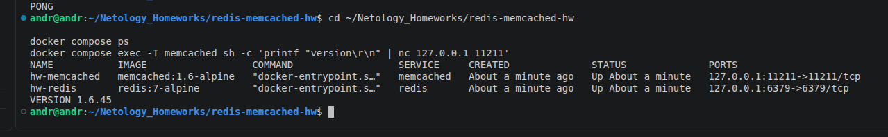
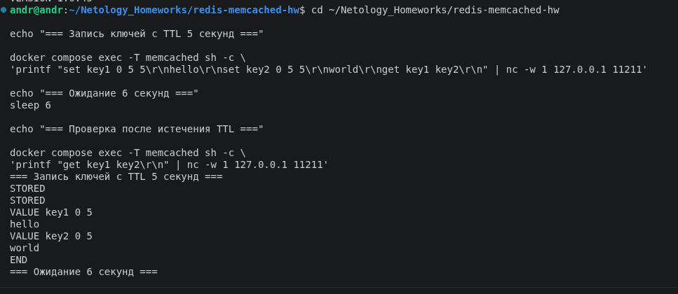
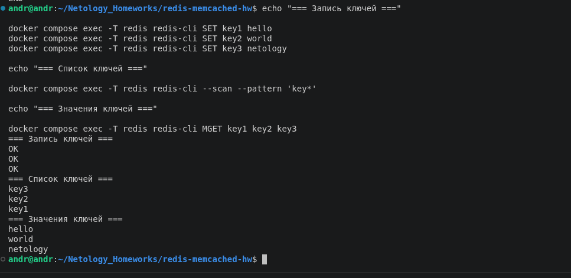
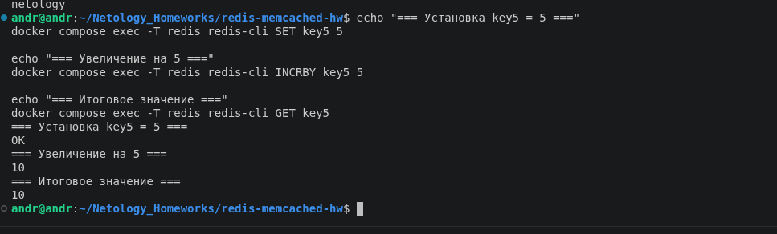

# Домашнее задание «Кеширование Redis/Memcached»

**Студент:** Лященко Андрей Сергеевич

## Задание 1. Кеширование

**Вопрос:** Какие проблемы решает кеширование?

**Ответ:** Кеширование ускоряет доступ к часто запрашиваемым данным, снижает нагрузку на базу данных и сервер, уменьшает задержки и помогает обслуживать больше пользователей.

## Задание 2. Memcached

**Вопрос:** Установить и запустить Memcached.

**Ответ:** Memcached запущен в Docker. Проверены состояние контейнера и ответ сервера `VERSION 1.6.45`. Вместо `systemctl status` использован `docker compose ps`, поскольку контейнер не использует systemd.

## Задание 3. TTL в Memcached

**Вопрос:** Записать несколько ключей с TTL 5 секунд и проверить их удаление.

**Ответ:** Записаны ключи `key1=hello` и `key2=world` с TTL 5 секунд. Сразу после записи значения доступны. После ожидания 6 секунд повторный запрос должен вернуть только `END`.

> Примечание: на приложенном скриншоте видны запись и чтение ключей, но результат повторного чтения после 6 секунд не попал в кадр. Для окончательной сдачи скриншот необходимо заменить.

## Задание 4. Redis

**Вопрос:** Записать несколько ключей и прочитать их через redis-cli.

**Ответ:** В Redis записаны `key1=hello`, `key2=world`, `key3=netology`. Ключи найдены через `--scan`, значения прочитаны через `MGET`.

## Задание 5*. Работа с числами

**Вопрос:** Создать `key5` со значением 5 и увеличить его на 5.

**Ответ:** Выполнены `SET key5 5`, `INCRBY key5 5` и `GET key5`. Итоговое значение — **10**.

