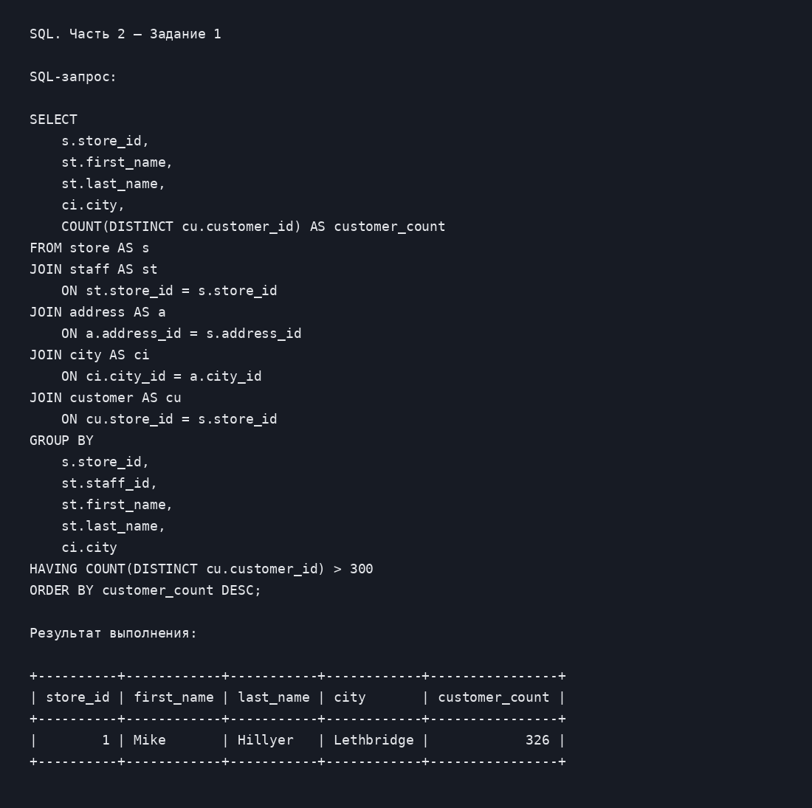
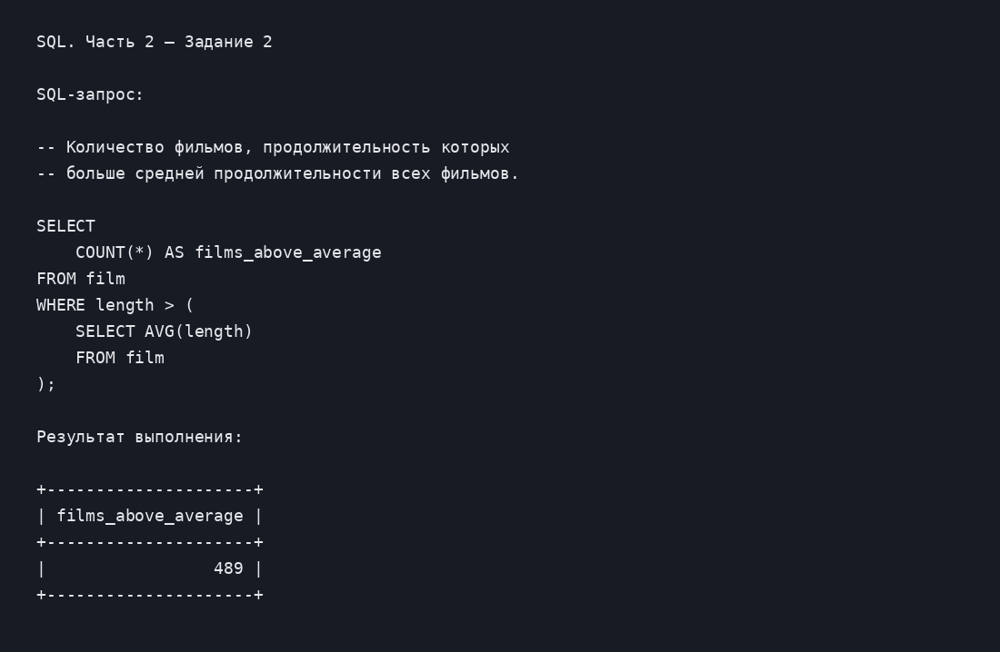
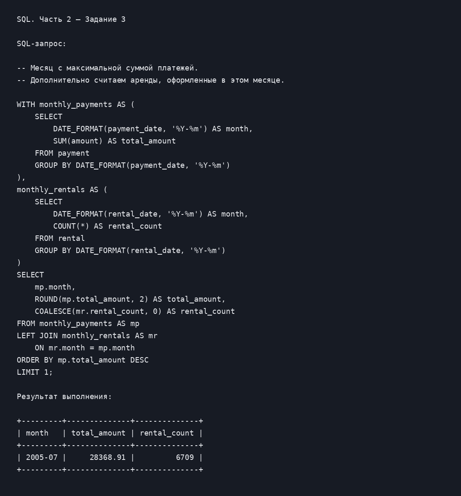
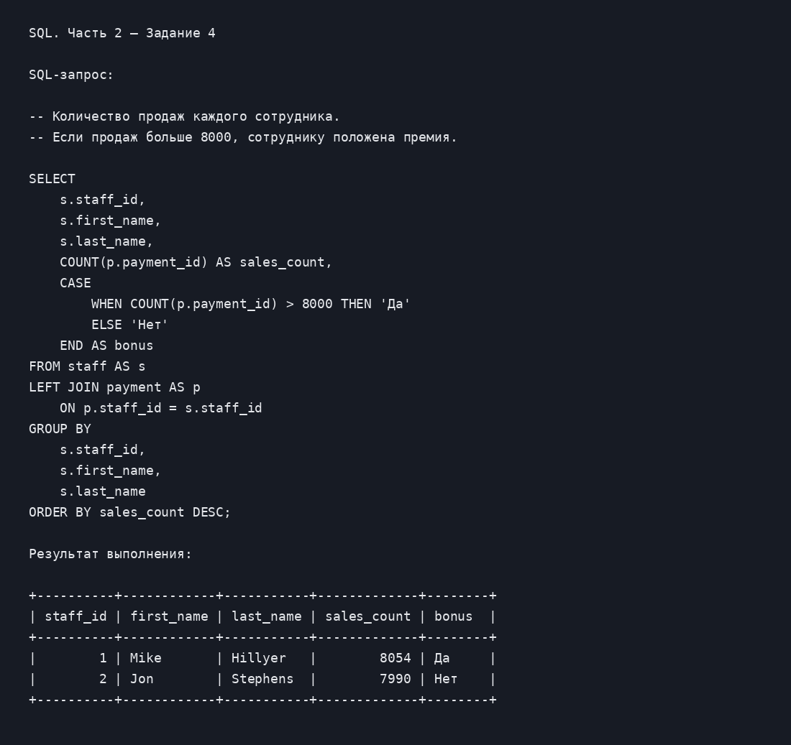
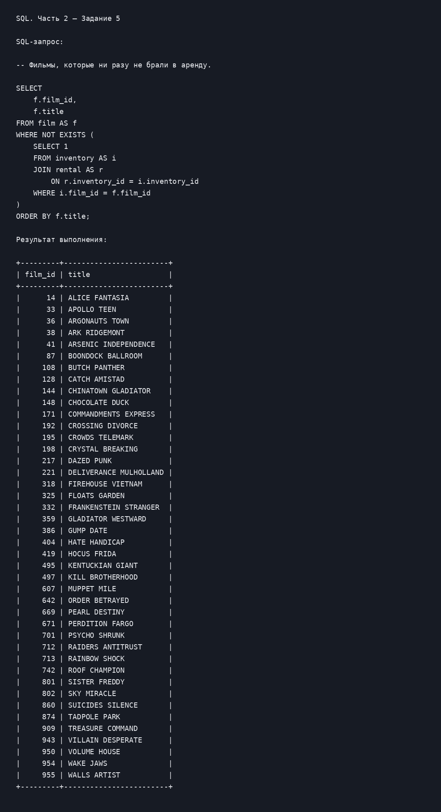

# Домашнее задание «SQL. Часть 2»

**Студент:** Andrey Lyaschenko

## Окружение

- Ubuntu Linux
- MySQL 8.0.46
- Docker Compose
- Учебная база данных Sakila
- Visual Studio Code
- Подключение к MySQL через SSH-туннель

## Задание 1

Получить информацию о магазине, обслуживающем более 300 покупателей.

**Результат:** Mike Hillyer, Lethbridge — 326 покупателей.

[SQL-запрос](sql/task_01.sql)

## Задание 2

Найти количество фильмов, продолжительность которых больше средней.

**Результат:** 489 фильмов.

[SQL-запрос](sql/task_02.sql)

## Задание 3

Определить месяц с наибольшей суммой платежей и количество аренд за этот месяц.

**Результат:** июль 2005 года, 28 368,91; 6709 аренд.

[SQL-запрос](sql/task_03.sql)

## Задание 4*

Подсчитать количество продаж каждого сотрудника и определить право на премию.

| Сотрудник | Продажи | Премия |
|---|---:|---|
| Mike Hillyer | 8054 | Да |
| Jon Stephens | 7990 | Нет |

[SQL-запрос](sql/task_04.sql)

## Задание 5*

Найти фильмы, которые ни разу не брали в аренду.

**Результат:** 42 фильма.

[SQL-запрос](sql/task_05.sql)

## Проверка

Все SQL-запросы успешно выполнены на MySQL 8.0.46 с базой Sakila.
